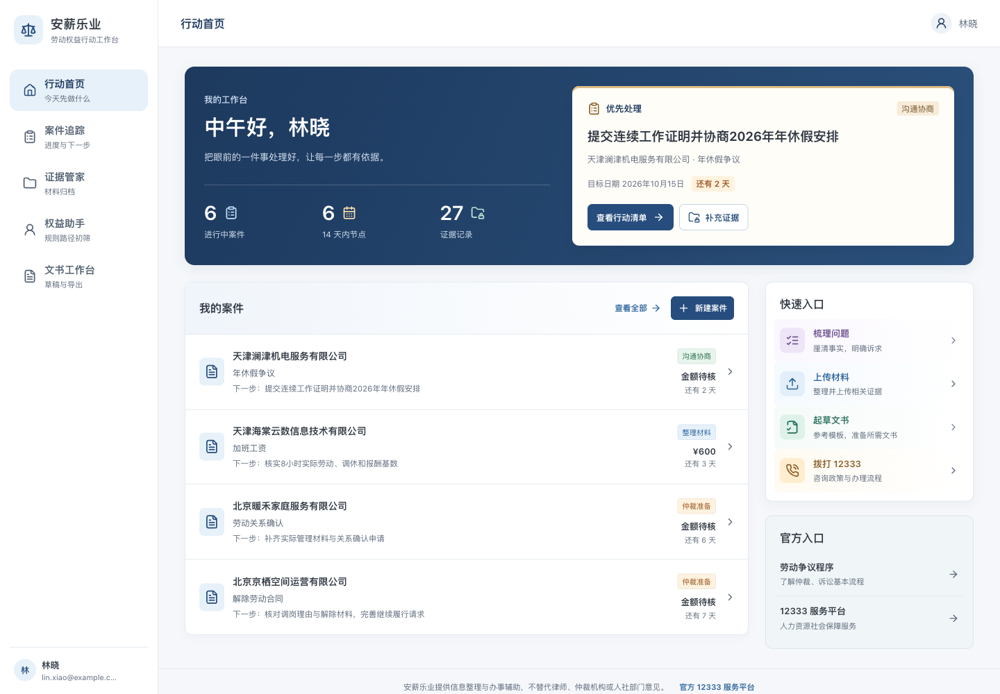
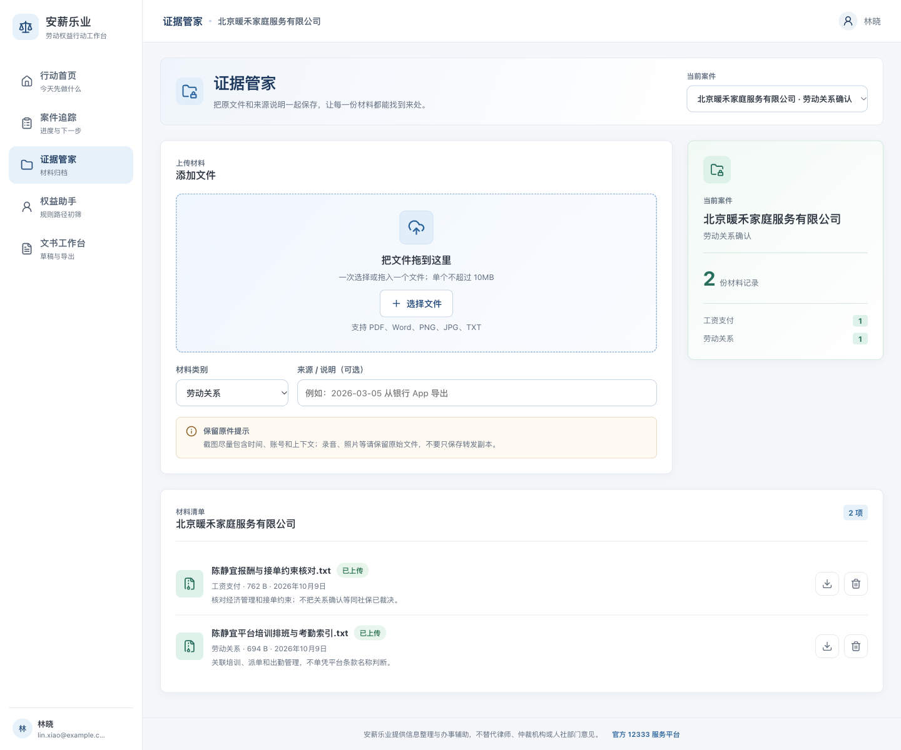
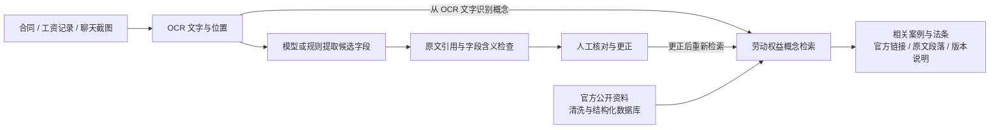

# 安薪乐业 · 让劳动材料可核对，让维权依据有出处

**面向欠薪与劳动关系确认的多模态材料整理与法律资料检索工作台。**

劳动者手中的合同照片、工资记录和聊天截图，往往分散在不同地方。安薪乐业把这些材料中的主体、日期、金额与工作安排整理为可核对的候选事实，再连接到带有官方出处的典型案例和法条，帮助使用者完成从“手里有材料”到“事实可整理、依据可查阅”的过程。

项目以 **多模态材料处理** 和 **可追溯劳动权益数据库** 为两条技术主线，将原件、提取结果、人工更正与公开资料放进同一工作流程。目前已交付可在本机运行的样例，覆盖合同图片、工资流水截图、聊天截图和扫描 PDF；案件管理、证据归档、规则咨询与文书草稿共同构成外围工作台。

[快速开始](#快速开始) · [材料样例](fixtures/material-demo/README.md) · [公开数据库](data/labor-public-v1/README.md) · [验证记录](docs/validation/README.md) · [功能 PR](https://github.com/ZZZZihan/anxin-work-rights/pull/24)



*当前演示界面，2026-10-13 重新截取，版本 `7e3d496`；画面使用合成演示数据。[截图来源记录](docs/images/README.md)。*

<details>
<summary>查看新版证据管家：劳动关系确认案件的材料归档</summary>



*同一演示版本下的证据管家，展示文件入口、材料分类、来源说明与已有合成材料。*

</details>

> 展示界面来自[界面 PR #19](https://github.com/ZZZZihan/anxin-work-rights/pull/19)，下文材料识别样例来自[功能 PR #24](https://github.com/ZZZZihan/anxin-work-rights/pull/24)。两条分支尚未整合；材料识别与出处定位的实际运行截图见[验证记录](docs/validation/README.md)。

## 两条技术创新主线

### 1. 原文约束的多模态材料处理

将图片、扫描 PDF 和文字材料转换为统一的“材料—文字片段—候选事实”结构，使识别结果可以回到原件核对。

- **从材料到字段**：合同整理单位、劳动者、岗位、入职日期与工资约定；工资记录整理付款日期与金额；聊天提取工作管理安排和欠薪陈述。
- **从字段回到原文**：每个候选字段保留原文摘录、文字块编号与页码。图片另保留文字区域坐标，点击“定位原文”即可查看对应位置。
- **以证据约束模型输出**：模型提取值必须逐字出现在引用片段中，引用必须来自真实 OCR 文字；日期、金额、岗位和管理安排再经过保守的字段含义检查。不符合条件的候选会被拒绝并提示原因。
- **保留人的判断**：原始提取值与用户修订分别保存，修改后重新核对；已保存结果刷新后可继续使用。系统不把候选字段直接写成法律事实，也不自动计算案件赔偿或认定劳动关系。

这一方向的应用创新在于把**识别、出处定位、拒绝不支持的候选和人工复核**一起设计，让使用者能够检查模型整理信息的依据。

当前已实测的是 Apple Vision OCR 与本地文字模型协作；默认模式为 OCR 加明确规则。这里的“多模态”指图片、扫描件与文字的统一处理流程。Ollama 视觉模型调用路径已实现，但本轮未取得可用的视觉模型验证结果，详见[处理服务说明](docs/material-extractor.md)。

### 2. 面向劳动争议的可追溯公开知识库

围绕欠薪和劳动关系确认，将免费获取的官方资料加工为可检索、可引用、可核查的领域数据，并直接接入材料整理流程。

| 数据组成 | 首版规模 | 如何使用 |
| --- | --- | --- |
| 官方来源页面 | 12 个 | 保存来源 URL、发布机构、采集时间及原始快照哈希 |
| 典型案例 | 14 例 | 按事实、争点披露情况、处理结果、理由和材料类型组织，包含劳动关系不成立的案例 |
| 法律法规、司法解释及规范文件 | 8 份 | 保存指定发布版本的全文来源和版本说明 |
| 相关条文 | 54 条 | 每条关联原文段落、所属文件和版本信息 |
| 交付格式 | SQLite、JSONL、原文快照与清洗文本 | 可离线查询、重建，并生成应用检索索引 |

数据库保留“案例事实摘录来自哪个官方段落、条文来自哪个版本”的对应关系。案例提及的材料只保存原文描述，未取得案件证据原件。未披露的裁判日期、地区等字段留空；网页发布日期、文件公布日期和施行日期分开记录。案例中明确出现的规则名称也单独关联，名称关联不代替适用版本核查。

应用从识别材料中提取劳动权益概念，检索相关案例和条文，展示原文摘录、官方链接、段落编号与版本说明。公开引用来自冻结数据索引，模型不能新增来源；没有相关命中时返回空结果。当前采用关键词、同义词与加权匹配，后续语义检索可在这一可复现基线上比较效果。

数据构建与检索细节见[数据库说明](data/labor-public-v1/README.md)、[来源清单](data/labor-public-v1/SOURCES.md)和[检索接入说明](docs/public-retrieval.md)。基础数据包保留采集阶段的独立说明，应用集成情况以本文和[材料样例说明](docs/material-demo.md)为准。免费访问不等于开放许可，来源材料的使用范围随数据包保留。

## 从上传到查阅依据



以一组合成材料为例：合同写明月工资 **8000 元**，到账记录显示付款 **6500 元**，聊天包含上班打卡要求及未发工资表述。系统分别整理这些信息、保留各自出处，并返回工资支付和劳动关系相关资料。它不会直接把两笔金额相减，宣布差额就是欠薪；工资所属期间、扣款原因及其他材料仍需核对。

原文摘录、模型候选、用户更正和公开法律资料在界面与数据中分别标注。这里形成的是可供人继续判断的事实整理与资料查阅流程，识别结果不代表材料真伪、证据效力或案件结论。

## 快速开始

需要 **Node.js 22.13+、Python 3.10+**。图片与 PDF 识别还需要 macOS、Swift 命令行工具及 Apple Vision/PDFKit；首次图片或 PDF 识别会编译本机 OCR 助手。其他平台可使用 UTF-8 TXT 跑通文本链路。

本说明对应材料识别功能分支。首次获取项目可运行：

```bash
git clone --branch feature/material-source-demo https://github.com/ZZZZihan/anxin-work-rights.git
cd anxin-work-rights
npm ci
npm run dev:materials
```

打开 **http://127.0.0.1:3013**，创建演示案件，进入“证据管家”：

1. 上传 [contract.png](fixtures/material-demo/contract.png)、[wage-statement.png](fixtures/material-demo/wage-statement.png) 或 [chat.png](fixtures/material-demo/chat.png)，选择对应材料类型。
2. 点击“识别并检索”，查看字段与原文；也可使用 [contract.pdf](fixtures/material-demo/contract.pdf) 测试扫描件。
3. 更正需要调整的字段，勾选“已与原文件核对”并保存。
4. 展开相关案例和法条，查看来源段落、官方链接与版本说明。

其他平台可上传 [facts.txt](fixtures/material-demo/facts.txt)，选择“劳动合同”，体验同一套文字提取、核对和检索流程。

所有附带材料均为明确标记的合成软件测试材料。单文件上限 10 MB，PDF 上限 5 页；Word 可归档和下载，识别前需转为 PDF 或图片。完整操作、失败恢复和保存方式见[材料样例使用说明](docs/material-demo.md)。

### 选择处理模式

| 模式 | 启动方式 | 当前验证情况 |
| --- | --- | --- |
| OCR + 规则 | `npm run dev:materials` | 已实测图片、PDF 与 TXT；不调用大模型 |
| OCR + Apple 本地文字模型 | 下方命令 | 已用合成材料完成真实模型调用和 HTTP 闭环；模型只接收 OCR 文字 |
| 已安装的 Ollama 视觉模型 | 配置本机模型名，见服务说明 | 调用路径已实现；27B 探针因内存停止，没有有效字段结果 |

在支持 Apple Intelligence 且系统模型已可用的本机运行：

```bash
ANXIN_MATERIAL_MODEL=apple-foundation-models npm run dev:materials
```

启动器不下载模型，不调用付费服务。显式选择的模型不可用时会显示失败，不静默替换为规则输出。切换配置只作用于新识别任务，已保存结果保留当时的处理方式。

若只开发基础工作台，可使用 `npm run dev`，以终端输出的地址为准；该命令不会启用材料处理服务。

## 技术架构与数据管理

| 层次 | 当前实现 |
| --- | --- |
| 交互界面 | React + Vinext，桌面与手机响应式工作台 |
| 应用 API | Vinext Route Handlers，浏览器经 `/api/*` 访问数据 |
| 案件与分析状态 | Cloudflare D1，记录用户归属、分析任务和核对修订 |
| 文件原件 | Cloudflare R2，分析前核验原件 SHA-256 |
| 本机材料处理 | Node.js 服务 + Swift Vision/PDFKit，支持显式配置本地模型 |
| 公开资料检索 | 从冻结 SQLite/JSONL 数据生成服务端索引，返回可核查出处 |

材料处理服务只监听本机回环地址，由应用后端持临时令牌调用；原件与分析按用户隔离，修订使用版本检查。删除材料时持久化取消分析，晚到结果不能恢复已删除数据；清理尚未确认时明确提示。公开检索展示劳动权益概念，不将姓名、公司名、账号或任意原文作为展示查询词。

本地 D1/R2 状态保存在项目内，开发启动会保留并升级已有数据，勿通过删除 `.wrangler/state` 升级。生产迁移由托管环境按 `drizzle/` 顺序执行。本机处理服务还没有部署为远程服务，不能直接将 `127.0.0.1` 配置用于远端 Worker。身份和部署细节见[架构说明](ARCHITECTURE.md)及[既有本地云环境说明](deploy/local-cloud/README.md)。

## 验证与可复现性

```bash
npm run check
```

检查包括类型、ESLint、应用测试、生产构建、公开数据与运行索引一致性，以及材料处理服务测试。已记录的功能候选为 [`7deb75e`](https://github.com/ZZZZihan/anxin-work-rights/commit/7deb75ef7b1aa170f39f9c14daf5c7c3ae5fa65e)，验证日期为 **2026-10-13**：

| 验证层次 | 已记录结果 |
| --- | --- |
| 应用 / 数据 / 本机处理服务 | 67 / 9 / 13 项通过；macOS 服务测试 0 跳过 |
| 隔离生产 HTTP | 原有应用 21 项、TXT 5 项、图片与 PDF 规则模式 14 项通过 |
| 真实 Apple 文字模型 HTTP | 14 项通过；合同图片 5 字段、工资 4 字段、聊天 3 条陈述、合同 PDF 5 字段逐项核对 |
| 真实浏览器 | 上传、识别、更正保存、刷新恢复、原图定位、出处展开、手机显示与损坏材料失败恢复 |
| 独立技术复核 | 应用集成、任务竞争、前端契约，以及提取出处与临时文件清理 |

详细报告、截图和源码哈希见[验证目录](docs/validation/README.md)；最新提交的自动检查见 [GitHub Actions](https://github.com/ZZZZihan/anxin-work-rights/actions/workflows/ci.yml)。Linux CI 验证 TXT 链路，不能代替 macOS 图像识别结果。

上述输入均为已知合成样例。提示与约束在这些样例上迭代，前期误分类和漏项报告完整保留；通过结果不代表留出集准确率、真实当事人材料准确率或法律专家验收。官方案例是典型案例摘要，法规保存指定版本，个案适用仍需核对。

## 后续研究方向

当前应用为进一步研究提供了可运行基线和可追溯数据。以下能力尚未完成，拟通过独立评估推进：

- **视觉与版面联合理解**：在受控资源条件下比较 OCR + 文字模型与视觉模型对复杂表格、截图关系和扫描件的处理效果。
- **多份材料交叉核对**：围绕同一案件连接主体、时间、金额及陈述，识别需要人工核对的冲突和材料缺口。
- **语义检索与引用评估**：比较关键词、向量和混合检索，评估相关资料召回、引用定位及无依据输出，保留“无匹配”的处理能力。
- **独立样本验证**：取得适当授权后扩展材料类型和表达方式，按案件划分评估集，区分字段提取、出处准确性与法律适用三个问题。

## 项目导航

| 位置 | 内容 |
| --- | --- |
| `app/`、`components/` | 页面、交互和 HTTP 路由 |
| `lib/material-*`、`scripts/material-*` | 材料分析、出处校验与本机处理 |
| `lib/public-retrieval*`、`scripts/build-public-index.py` | 公开资料检索与运行索引构建 |
| `data/labor-public-v1/` | 独立数据库样例、来源、清洗结果与发布格式 |
| `fixtures/material-demo/` | 可直接上传的合成演示材料 |
| `docs/`、`docs/validation/` | 使用说明、实现边界与验证证据 |
| `db/`、`drizzle/` | 数据结构与按顺序执行的迁移 |

项目通过 GitHub PR 维护，功能提交、检查通过、合并和部署分别记录。“权益助手”目前提供规则路径提示，文书输出为可编辑草稿；使用者在实际使用前仍需核对主体、金额、日期、请求与证据。
