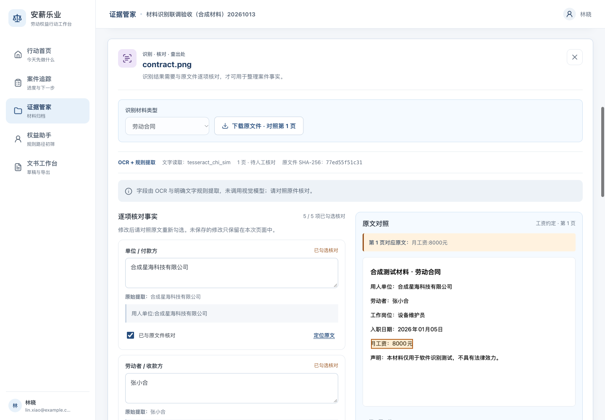
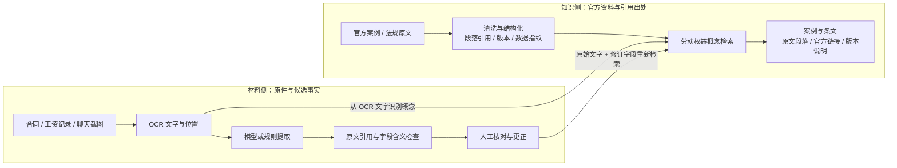

# 安薪乐业 ANXIN

### 多模态证据智能与法律知识协同平台

**让材料信息可核对，让维权依据可追溯。**

安薪乐业面向**欠薪与劳动关系确认**，将合同照片、工资记录、聊天截图和扫描件中的关键信息，转化为带有原文引用的候选事实，并连接到官方公开案例与法条。项目将多模态材料处理、领域知识工程与人工核对组织成连续流程，为劳动者提供从材料整理到行动准备的数字化支持。

核心设计是**让信息始终携带出处**：机器提取保留原文位置，公开资料保留官方来源，人工更正保留原始提取值。使用者可以检查信息从哪里来，再决定如何使用。

[技术创新](#技术创新) · [工作流程](#工作流程) · [快速开始](#快速开始) · [公开数据库](data/labor-public-v1/README.md) · [验证记录](docs/validation/README.md)

[在线体验整合版 →](http://172.23.1.127/) · [本次部署与完整流程验收](docs/validation/material-live-20261013/README.md)


*2026-10-13 从实际网站截取，部署版本 `0cadf0f`。新版界面、材料识别与公开资料检索已在同一实例整合，图中均为合成演示数据。[截图来源与校验](docs/images/README.md)。*

<details>
<summary>查看已上线的材料识别工作台：字段核对与原文定位</summary>



*来自实际上传后的运行页面。合同图片、工资流水、聊天截图及扫描 PDF 均已在网站完成识别和案例、法条检索；官方出处可展开并跳转。测试材料在验收后删除，测试案件归档。[完整验收证据](docs/validation/material-live-20261013/README.md)。*

</details>

## 项目价值

劳动权益准备中的一个具体难题，是把分散的材料组织成可以继续查阅、核对和使用的信息。合同中的工资约定、到账记录中的付款金额、聊天中的工作安排，各自反映不同事实；找到相关法条之后，还需要知道原文内容与版本。

安薪乐业围绕这条使用路径组织产品：

| 使用环节 | 平台提供的支持 | 用户得到的结果 |
| --- | --- | --- |
| 材料归集 | 按案件保存文件、材料类别与来源说明 | 原件有归处，后续核对有入口 |
| 事实整理 | 提取主体、日期、金额和工作安排，保留引用位置 | 形成可逐项核对的候选事实 |
| 依据查阅 | 检索官方案例与条文，展开原文、链接和版本说明 | 参考资料有出处，引用内容可查证 |
| 行动准备 | 案件进度、证据归档、规则路径提示与文书草稿 | 在工作台中继续组织维权准备 |

## 技术创新

项目的应用创新聚焦两个相互衔接的问题：**如何让机器整理的信息有据可查，以及如何让领域知识带着出处进入实际工作流程。** 两条主线分别构建材料侧与知识侧的溯源机制，通过人工核对连接起来。

### 01 · 证据锚定的多模态信息抽取

以“原件—文字片段—候选字段”为统一信息结构，将图片、扫描 PDF 与文本接入同一套核对流程。模型或规则参与字段整理，出处校验约束输出，使用者保留最终核对权。

- **结构化抽取**：合同整理单位、劳动者、岗位、入职日期与工资约定；工资记录整理付款日期与金额；聊天整理工作管理安排和工资支付表述。模型输出限定在预设字段结构中。
- **原文锚定**：候选字段携带原文摘录、文字块编号与页码。图片支持对应区域高亮；PDF 支持页码与 OCR 文字定位。原件 SHA-256 将分析结果绑定到所处理的文件。
- **约束式校验**：机器提取值必须逐字出现在引用片段中，引用片段必须来自真实 OCR 文字。日期、金额、岗位等再经过有限的字段含义检查；缺少支持的候选被拒绝，并给出提示。
- **人机协同复核**：原始提取值、用户修订和核对状态分别保存。更正后，系统结合原始 OCR 文字与修订后的字段重新检索资料；刷新后可继续查看已保存结果。

**技术价值：把模型输出组织成可检查的信息对象。** 使用者既能看到候选结果，也能回查产生结果的文字片段；人工更正不会覆盖原始提取值。

当前网站使用 Linux Tesseract / Poppler OCR 加规则；macOS 的 Apple Vision 与本地文字模型协作另有本机运行记录。“多模态”描述图片、扫描件和文字的统一处理流程；具体模型模式与验证范围见[快速开始](#快速开始)及[处理服务说明](docs/material-extractor.md)。

### 02 · 面向劳动争议的可溯源知识工程

将免费获取的官方资料加工为具备**领域结构、段落引用、版本说明与数据指纹**的知识库。资料从采集、清洗、结构化到应用检索，保留可以逐级核查的来源关系。

- **按问题组织知识**：围绕欠薪与劳动关系确认，分别保存案例事实、争点披露情况、处理结果、理由和材料描述；法规按文件与条文组织，案例中明确提及的规则保留名称关联。
- **按段落记录出处**：案例内容字段与条文连接到官方原文段落，保存发布机构、来源 URL、采集时间及原始快照哈希。未披露的地区、裁判日期等保持为空。
- **让版本信息随结果呈现**：数据层分开记录网页发布日期、文件公布日期和施行日期；检索结果携带资料版本说明、来源时间与数据指纹，便于核对结果来自哪一批资料。
- **以可复现流程维护数据**：从冻结快照重新提取，校验原文、引用、条文及数据一致性，再生成 SQLite、JSONL 和应用索引，为后续检索方法比较保留固定基线。

**技术价值：让领域数据成为可查询、可引用、可重建的应用基础。** 当前检索从材料中识别劳动权益概念，展开同义词并按字段加权匹配，返回有实际命中的案例和条文；引用取自固定索引，没有匹配时返回空结果。

首版数据资产规模如下，统计来自[数据质量报告](data/labor-public-v1/release/quality-report.json)：

| 数据资产 | 首版规模 | 组织方式 |
| --- | --- | --- |
| 官方来源页面 | 12 个 | 原始快照、清洗文本、机构、URL 与采集记录 |
| 典型案例 | 14 例 | 事实、结果、理由与材料描述，含劳动关系不成立案例 |
| 法律法规、司法解释及规范文件 | 8 份 | 指定发布版本的全文来源与版本说明 |
| 相关条文 | 54 条 | 完整选定条文及对应原文段落 |
| 字段引用关联 | 620 条 | 结构化内容字段到来源段落的引用映射 |
| 数据交付 | SQLite + JSONL | 可离线查询、重建并生成应用检索索引 |

案例来自官方典型案例汇编，案例中的材料描述与用户上传原件分别管理；数据包未取得案件证据原件。数据构建、来源与使用范围见[数据库说明](data/labor-public-v1/README.md)、[来源清单](data/labor-public-v1/SOURCES.md)和[检索接入说明](docs/public-retrieval.md)。

## 工作流程

**材料归集 → 候选事实 → 人工核对 → 资料查阅 → 行动准备。** 材料侧回答“这项信息在原件哪里”，知识侧回答“这条参考来自哪个官方来源”。



两类出处在界面中分别呈现：原文位置用于核对材料记载，官方段落用于查阅参考资料。相关案例和法条的命中，仍需使用者结合案件事实判断适用性。

### 一个可演示的场景

一组合成材料包含三项信息：合同写明月工资 **8000 元**，到账记录显示付款 **6500 元**，聊天记载上班打卡要求和未发工资表述。

使用者逐份上传后，可以查看工资约定、付款金额与工作安排等候选字段，回到各自原文核对，再打开工资支付和劳动关系相关资料的官方出处。原始提取与人工修订分别保留，案件与文书工作台承接后续准备。

本例展示的是逐份材料的结构化与引用检索。系统不自动把金额差额认定为欠薪，也不自动判定劳动关系；工资期间、扣款原因及多份材料之间的关系仍由人核对。[使用合成材料体验完整流程 →](fixtures/material-demo/README.md)

## 当前展示入口

[打开安薪乐业工作台](http://172.23.1.127/)（需处于可访问该内网地址的网络）。网站使用共享合成展示数据。新材料流程位于“证据管家”：选择案件，上传合同、工资记录、聊天截图或 PDF，开始识别，核对字段，再展开案例和法条出处。

当前发布为 `0cadf0f`，使用 OCR + 规则，未开启大模型。该地址属于内网，共享展示环境请使用合成材料体验。代码、验证记录与合并状态见[整合 PR #26](https://github.com/ZZZZihan/anxin-work-rights/pull/26)。

本地普通 HTTP 展示可运行 `npm run demo`；隔离环境和停止方式见[展示部署说明](deploy/synthetic-http/README.md)。

## 快速开始

需要 **Node.js 22.18+、Python 3.10+**。图片与 PDF 可在 macOS（Swift、Apple Vision/PDFKit）或 Linux（Tesseract、chi_sim 中文语言包、Poppler）处理。macOS 首次使用编译本机助手；Debian/Ubuntu 可安装 `tesseract-ocr tesseract-ocr-chi-sim poppler-utils`。其他平台可用 UTF-8 TXT。

从主仓库获取包含材料识别样例的代码并启动：

```bash
git clone https://github.com/ZZZZihan/anxin-work-rights.git
cd anxin-work-rights
git switch main
npm ci
npm run dev:materials
```

打开 **http://127.0.0.1:3013**，创建演示案件，进入“证据管家”：

1. 上传 [contract.png](fixtures/material-demo/contract.png)、[wage-statement.png](fixtures/material-demo/wage-statement.png) 或 [chat.png](fixtures/material-demo/chat.png)，选择对应材料类型。
2. 点击“识别并检索”，查看字段与原文；也可使用 [contract.pdf](fixtures/material-demo/contract.pdf) 测试扫描件。
3. 更正需要调整的字段，勾选“已与原文件核对”并保存。
4. 展开相关案例和法条，查看来源段落、官方链接与版本说明。

没有配置 OCR 的平台可上传 [facts.txt](fixtures/material-demo/facts.txt)，选择“劳动合同”，体验同一套文字提取、核对和检索流程。

所有附带材料均为明确标记的合成软件测试材料。单文件上限 10 MB，PDF 上限 5 页；Word 可归档和下载，识别前需转为 PDF 或图片。完整操作、失败恢复和保存方式见[材料样例使用说明](docs/material-demo.md)。

### 选择处理模式

| 模式 | 启动方式 | 当前验证情况 |
| --- | --- | --- |
| OCR + 规则 | `npm run dev:materials` | 已实测图片、PDF 与 TXT；不调用大模型 |
| OCR + Apple 本地文字模型 | 下方命令 | 已用合成材料完成真实模型调用和 HTTP 闭环；模型只接收 OCR 文字 |
| 已安装的 Ollama 视觉模型 | 配置本机模型名，见服务说明 | 调用路径已实现；27B 探针因内存停止，没有有效字段结果 |

在支持 Apple Intelligence 且系统模型已可用的本机运行：

```bash
ANXIN_MATERIAL_MODEL=apple-foundation-models npm run dev:materials
```

启动器不下载模型，不调用付费服务。显式选择的模型不可用时会显示失败，不静默替换为规则输出。切换配置只作用于新识别任务，已保存结果保留当时的处理方式。

若只开发基础工作台，可使用 `npm run dev`，以终端输出的地址为准；该命令不会启用材料处理服务。

## 技术架构与数据管理

| 层次 | 当前实现 |
| --- | --- |
| 交互界面 | React + Vinext，桌面与手机响应式工作台 |
| 应用 API | Vinext Route Handlers，浏览器经 `/api/*` 访问数据 |
| 案件与分析状态 | Cloudflare D1，记录用户归属、分析任务和核对修订 |
| 文件原件 | Cloudflare R2，分析前核验原件 SHA-256 |
| 材料处理服务 | Node.js；Linux Tesseract/Poppler，macOS Vision/PDFKit；本机可显式配置模型 |
| 公开资料检索 | 从冻结 SQLite/JSONL 数据生成服务端索引，返回可核查出处 |

材料处理服务只监听本机回环地址，由应用后端持私有令牌调用（开发启动临时生成，部署从受限配置读取）；原件与分析按用户隔离，修订使用版本检查。删除材料时持久化取消分析，晚到结果不能恢复已删除数据；清理尚未确认时明确提示。公开检索展示劳动权益概念，不将姓名、公司名、账号或任意原文作为展示查询词。

本地 D1/R2 状态保存在项目内，开发启动会保留并升级已有数据，勿通过删除 `.wrangler/state` 升级。生产迁移由托管环境按 `drizzle/` 顺序执行。当前 Debian 展示实例的 Worker 与材料伴随服务在同一主机，已接通回环调用；Cloudflare 云端 Worker 无法访问这台主机的 `127.0.0.1`，需要另行设计服务网络。身份和部署细节见[架构说明](ARCHITECTURE.md)及[既有本地云环境说明](deploy/local-cloud/README.md)。

## 验证与可复现性

```bash
npm run check
```

检查包括类型、ESLint、应用测试、生产构建、公开数据与运行索引一致性，以及材料处理服务测试。

**最新整合发布 `0cadf0f`**：目标 Debian 的 107 项应用/部署测试、9 项数据测试、24 项材料服务测试全部通过；隔离 HTTP 为基础展示 30 项、文字材料 8 项、图片/PDF 17 项。实际网站通过四类材料完整流程和五页面 × 三种宽度检查，详见[发布验收记录](docs/validation/material-live-20261013/README.md)与[该候选 CI](https://github.com/ZZZZihan/anxin-work-rights/actions/runs/38354457745)。图片语义回归显式允许六种中英文标点等价，原始 OCR 和出处不改写；不代表任意真实材料准确率。

以下保留历史本机功能验证：已记录的功能候选为 [`7deb75e`](https://github.com/ZZZZihan/anxin-work-rights/commit/7deb75ef7b1aa170f39f9c14daf5c7c3ae5fa65e)，验证日期为 **2026-10-13**：

| 验证层次 | 已记录结果 |
| --- | --- |
| 应用 / 数据 / 本机处理服务 | 67 / 9 / 13 项通过；macOS 服务测试 0 跳过 |
| 隔离生产 HTTP | 原有应用 21 项、TXT 5 项、图片与 PDF 规则模式 14 项通过 |
| 真实 Apple 文字模型 HTTP | 14 项通过；合同图片 5 字段、工资 4 字段、聊天 3 条陈述、合同 PDF 5 字段逐项核对 |
| 真实浏览器 | 上传、识别、更正保存、刷新恢复、原图定位、出处展开、手机显示与损坏材料失败恢复 |
| 独立技术复核 | 应用集成、任务竞争、前端契约，以及提取出处与临时文件清理 |

详细报告、截图和源码哈希见[验证目录](docs/validation/README.md)；最新提交的自动检查见 [GitHub Actions](https://github.com/ZZZZihan/anxin-work-rights/actions/workflows/ci.yml)。上述记录是原 macOS 样例的历史验收。整合版新增 Linux 中文 OCR，CI 同时检查中文引擎和图片/PDF链路；实际部署结果见后续独立发布记录。

公开资料的免费访问不等于开放许可，来源权利信息与版本限制随数据包保留。基础数据包说明记录采集阶段的独立交付，应用集成情况以本文及[材料样例说明](docs/material-demo.md)为准。

上述输入均为已知合成样例。提示与约束在这些样例上迭代，前期误分类和漏项报告完整保留；通过结果不代表留出集准确率、真实当事人材料准确率或法律专家验收。官方案例是典型案例摘要，法规保存指定版本，个案适用仍需核对。

## 研究演进路线

当前版本已形成“材料处理、候选校验、人工核对、出处检索”的可运行基线。下一阶段围绕以下问题开展比较实验；表内能力与评估均为后续计划，尚未完成。

| 研究问题 | 拟比较或构建的能力 | 关注的验证指标 |
| --- | --- | --- |
| 复杂版式能否得到更好的理解？ | 在受控资源下比较 OCR + 文字模型与视觉模型，覆盖表格、截图和扫描件 | 字段准确性、原文定位、漏项、耗时与资源占用 |
| 多份材料能否协同核对？ | 连接同案主体、时间、金额及陈述，标出待核对的冲突和材料缺口 | 主体对齐、冲突检出、误报与人工核对成本 |
| 相关依据能否检索得更准确？ | 在固定数据集上比较关键词、向量与混合检索 | 相关资料召回、排序、引用定位与无匹配处理 |
| 方法能否适应未见过的材料？ | 取得授权后扩展材料类型，按案件划分独立评估集 | 字段提取、出处准确性与不同材料类型下的表现 |

通过固定来源、保留失败记录和独立样本评估，后续研究可以分别衡量模型能力、检索质量与人机协作效果。法律适用判断另需法律专业人员核查。

## 项目导航

| 位置 | 内容 |
| --- | --- |
| `app/`、`components/` | 页面、交互和 HTTP 路由 |
| `lib/material-*`、`scripts/material-*` | 材料分析、出处校验与本机处理 |
| `lib/public-retrieval*`、`scripts/build-public-index.py` | 公开资料检索与运行索引构建 |
| `data/labor-public-v1/` | 独立数据库样例、来源、清洗结果与发布格式 |
| `fixtures/material-demo/` | 可直接上传的合成演示材料 |
| `docs/`、`docs/validation/` | 使用说明、实现边界与验证证据 |
| `db/`、`drizzle/` | 数据结构与按顺序执行的迁移 |

项目通过 GitHub PR 维护，功能提交、检查通过、合并和部署分别记录。“权益助手”目前提供规则路径提示，文书输出为可编辑草稿；使用者在实际使用前仍需核对主体、金额、日期、请求与证据。
