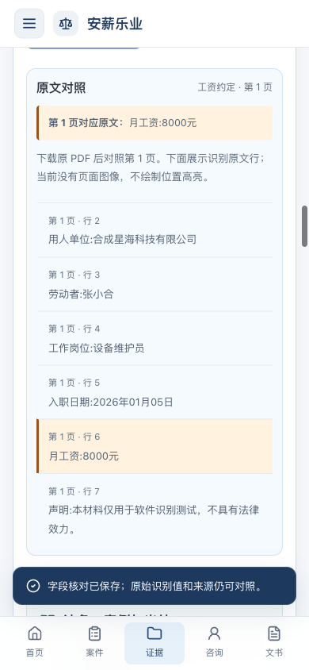

# 新版界面与材料识别整合部署验收

2026-10-13，整合版已部署到 [安薪乐业工作台](http://172.23.1.127/)。真实浏览器完成了合同图片、工资到账截图、聊天截图和扫描 PDF 的上传、信息提取、人工核对、案例与法条检索、来源段落查看和官方原文跳转。该地址属于内网，需要处于能访问该地址的网络。

## 版本与运行方式

- 实际部署代码：`0cadf0f780557acea64b9b096161744591d8d5d0`；此前版本：`7e3d496f56a81de6fe535432d598517b5e618121`。
- 环境标识：`06d13325-3782-4564-8ec9-35f1264f6773`，沿用既有 D1/R2 数据目录，没有创建空实例或重新导入。
- [整合 PR #26](https://github.com/ZZZZihan/anxin-work-rights/pull/26) / [Issue #25](https://github.com/ZZZZihan/anxin-work-rights/issues/25)。此次部署不等于主分支合并；PR 保持未合并。
- 本目录与 README 截图的后续提交只归档验证和说明；线上程序仍明确绑定上述代码提交。
- Debian 12、Node 24.21.0，Tesseract 5.3.0 / `chi_sim`、Poppler 22.12.0。当前结构化模式为 `ocr_rules`，`model: null`，没有在网站启用大模型或视觉语言模型。

## 实际网站上的完整流程

全部使用仓库内明确标记的合成材料，在浏览器新建案件“材料识别联调验收（合成材料）20261013”后操作。

| 上传材料 | 浏览器实际核对的结果 | 检索与出处 |
| --- | --- | --- |
| `contract.png` | 单位、劳动者、岗位、入职日期、8000 元工资约定，共 5 字段 | 显示案例与法条；工资原图区域实际高亮 |
| `wage-statement.png` | 6500 元、2026 年 02 月 10 日及收付款主体，共 4 字段 | 显示案例与法条 |
| `chat.png` | 打卡工作安排及两条工资支付表述，共 3 字段 | 显示案例与法条，保留 OCR 的原始标点 |
| `contract.pdf` | 同一合同的 5 个预设字段全部正确 | 通过页码和 OCR 文字定位；显示案例与法条 |

合同工资字段先从 8000 元改为测试值 8500 元并勾选核对、保存，刷新后仍为 8500 元，原始提取值和 quote 仍保留 8000 元。验证后在界面恢复为 8000 元并重新核对。该操作用于验证修订持久化，不代表合成原件记载 8500 元。见 [修订时的真实响应](live-corrected-contract.json)和[最终四份材料结果](live-material-results.json)。上传原件逐份下载后与本地夹具 SHA-256 一致。

展开案例和法条后，界面显示来源段落编号、原文摘录、发布机构、收录时间和版本说明。实际点击“查看官方原文”，浏览器成功打开最高人民法院的涉欠薪典型案例页，以及国家市场监督管理总局发布的《中华人民共和国劳动合同法》页，并检查到预期正文。[官方页面浏览器结果](official-source-browser.json)、[来源界面快照](browser-sources-snapshot.txt)。

390 × 844 手机视口中实际操作 PDF 字段核对、保存与原文定位。页面宽度与内容宽度均为 390，五个字段输入框字号均为 16px；PDF 页码与工资原文可见。[手机操作结果](mobile-material-browser.json)。PDF 当前提供页码及文字定位，未提供页面图像框选高亮。

损坏 PNG 实际上传后，首次识别及主动重试均显示“图片无法读取，请确认 PNG 文件完整”，没有产生候选字段；随后在浏览器确认删除。[失败与重试结果](broken-material-browser.json)。服务重启后失效任务的恢复，在隔离的真实 HTTP 服务回归中验证，不冒充线上故障演练。

## 分环境验证

| 环境与候选 | 实际检查 | 结果 |
| --- | --- | --- |
| 本机 macOS，`0cadf0f` | 类型、ESLint、构建；107 项应用/部署测试；9 项数据测试；材料服务测试 | 通过；材料 23 通过、1 项仅 Linux 真实 Tesseract 测试按平台跳过，Apple Vision 实际路径执行 |
| Ubuntu GitHub CI，`0cadf0f` | 必需检查、基础 HTTP、展示隔离与生命周期、TXT 和图片/PDF 材料 HTTP | [全部通过](https://github.com/ZZZZihan/anxin-work-rights/actions/runs/38354457745) |
| 目标 Debian，`0cadf0f` | 同一 Git 归档构建；107 项应用/部署、9 项数据、24 项材料服务 | 全部通过，材料测试零跳过 |
| 目标 Debian，独立测试状态 | 展示 HTTP 30 项、TXT HTTP 8 项、图片/PDF HTTP 17 项 | 全部通过；含所有权拒绝后的状态/原件检查、服务真实重启、显式重试、修订保存及删除 |
| 实际网站浏览器 | 上述四类材料完整流程、修订刷新、原文和官方出处、手机操作、坏图失败 | 通过；测试材料均为合成夹具 |
| 实际网站独立只读浏览器 | 五页 × 320/390/1440 宽度，共 15 组合；248 次 `trial` 控件可操作性检查 | 15/15 通过；无横向溢出，错误列表为空，业务写请求为 0 |

对应证据：[本机检查](local-check-216.txt)、[Debian 检查](debian-check.log)、[Debian 展示 HTTP](debian-synthetic.json)、[Debian TXT](debian-text.json)、[Debian 图片/PDF](debian-images.json)、[CI 图片/PDF](ci/http-images.json)、[独立布局报告](readonly-ui/readonly-layout-review.md)、[布局原始数据](readonly-ui/layout-report.json)。早期 `1b676e0` 的本地基础 HTTP 和检查另保存在本目录，不替代最终候选证据。归档日志副本仅清理行尾空白以通过仓库格式检查，未删改检查结果或失败信息；未规范化的运行输出保留在本机工作目录。

TXT 语义比较为 `exact`。图片/PDF 回归显式使用 `punctuation-equivalence`，仅在测试预期比较中允许 `，？：；。！` 与对应 ASCII 标点等价；汉字、金额、日期不放宽。实际 OCR 文字、字段与 quote 不被改写，引用仍须逐字对应实际文字块。严格比较因聊天问号 `?` 与 `？` 不同而失败的[原始报告](debian-images-exact.json)完整保留。

## 初始失败与 PDF 修复

初始候选 `1b676e0` 在 Debian 和 CI 的 PDF 回归失败：144 DPI 合同漏识“用人单位”的“用”，缺少单位字段。目标 Debian 对同一合成 PDF 比较 144、216、300 DPI；216 提取出五字段，300 反而出现分行和误字。因此采用 216 DPI，并让渲染前尺寸检查使用同一个常量，保持 8192 边长、4000 万像素、5 页和 60 秒限制。

[原始 DPI 对照](dpi-probe/pdf-dpi-probe.json)和[初始 PDF 失败](initial-failures/debian-images-pdf.json)均保留。Mac 上直接调用 Tesseract helper 的 216 DPI [负结果](dpi-probe/pdf-dpi-local-comparison.json)也保留；macOS 受支持服务路径使用 Apple Vision，其真实测试另行执行。这是受控夹具上的工程调参和回归，不是任意真实材料的准确率评估。

## 数据保留、清理与运行边界

切换完成、尚未写测试数据时，5 个完整业务数组及 27 份原件的哈希均与切换前一致：8 个未归档案件、7 个归档案件、27 份材料、32 条消息、15 份文书；原件共 16491 字节。[切换后报告](data-after-deploy.json)。

本次浏览器新增的合成案件 ID 为 `da046f43-4706-43bb-b609-473a0e5faf44`。坏图由 UI 删除，另四份材料通过应用 HTTP 按精确案件和材料 ID 清理，并验证分析及原件下载均返回 404；案件在 UI 归档。现有归档列表因此多 1 个空的合成验收案件。排除且仅排除此新案件后，再次核对原 5 数组和全部 27 原件，哈希仍完全一致。[清理记录](live-test-cleanup.json)、[验收后原数据核对](data-after-browser-cleanup.json)。首次清理请求遗漏 Origin 被网关以 403 拒绝，四条测试记录仍存在；随后使用正常同源请求完成清理，没有调整安全配置。

新 release 保留的 50 份旧静态资源经实际 HTTP 逐项校验均为 200 且 SHA-256 一致。[旧资源报告](old-static-assets.json)。原 nginx 和独立 HTTPS 服务的 PID、InvocationID 与切换前一致，[旁路服务报告](services-preserved.json)。

私有停止状态备份位于服务器 `/home/carryz/.local/share/anxin-synthetic-backups/20261013-0cadf0f`；归档校验通过，未将备份或密钥提交到仓库。网关、Worker、材料服务分别仅在回环 18090、18897、18898 端口运行，由原入口转发。材料 token 保存在受限私有配置中，核查未出现在两个服务日志。[部署审计](remote-audit.json)、[验收后服务审计](remote-audit-after-browser.json)。

当前 user units 为 transient 持续展示服务，`expiresAt: null` 不等于整机重启后自动恢复；没有实施或验证开机自启。本次没有主动执行线上失败回退或备份恢复演练，也没有改变独立 HTTPS 服务。公开资料来自冻结数据库样例，版本说明随结果呈现，未新增法律专家复核。

## 协作复核

3 名子 Agent 分别承担 Linux OCR、部署接线、界面整合，并交叉复核非本人实现；主 Agent 完成集成、Git、实际部署、浏览器功能验收和数据核对。所有子 Agent 请求配置为 `gpt-6.1-sol / ultra`；实际运行参数无法通过本次工具结果独立核验。见[独立复核范围与证据](independent-review.json)。技术验收和用户人工认可分别记录，本报告不代表用户已完成界面验收。
